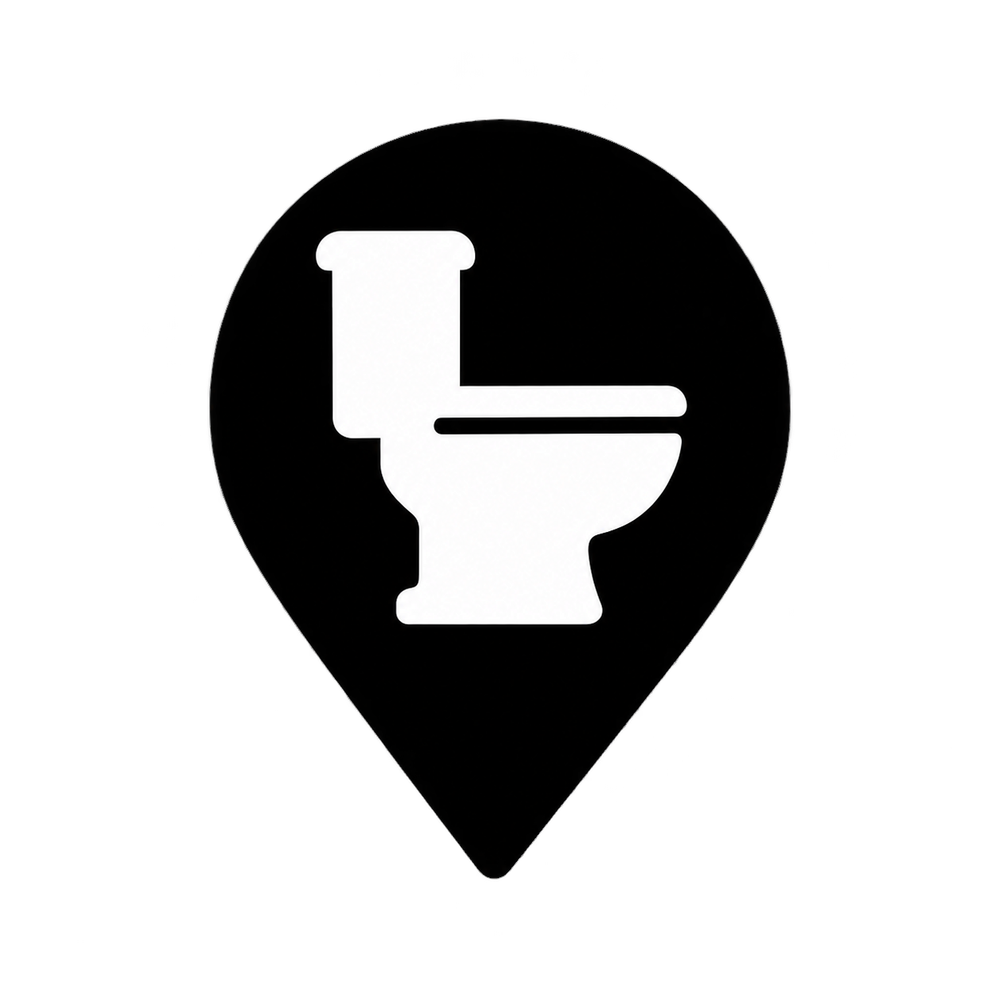
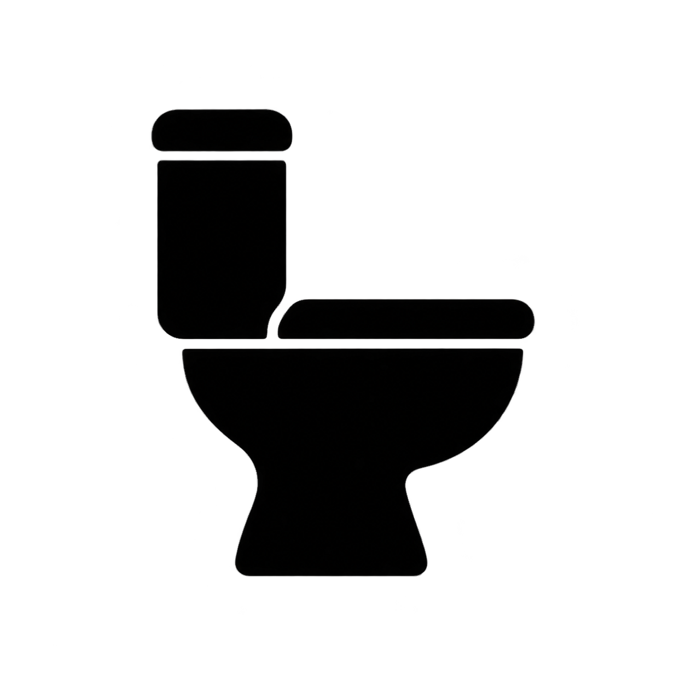
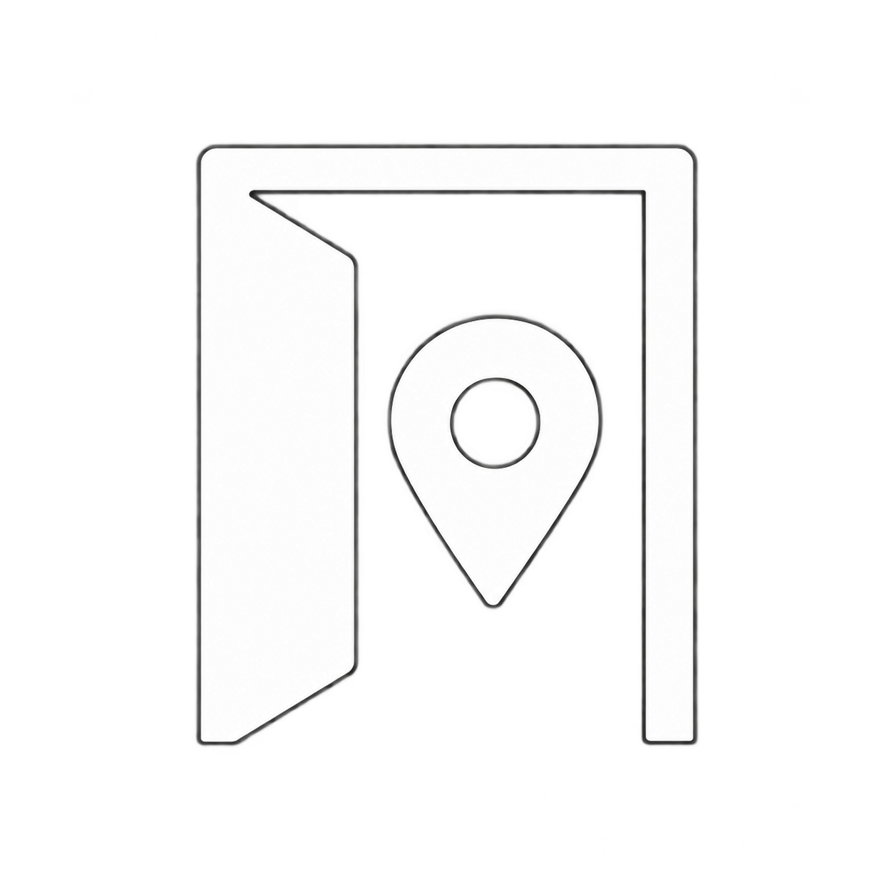
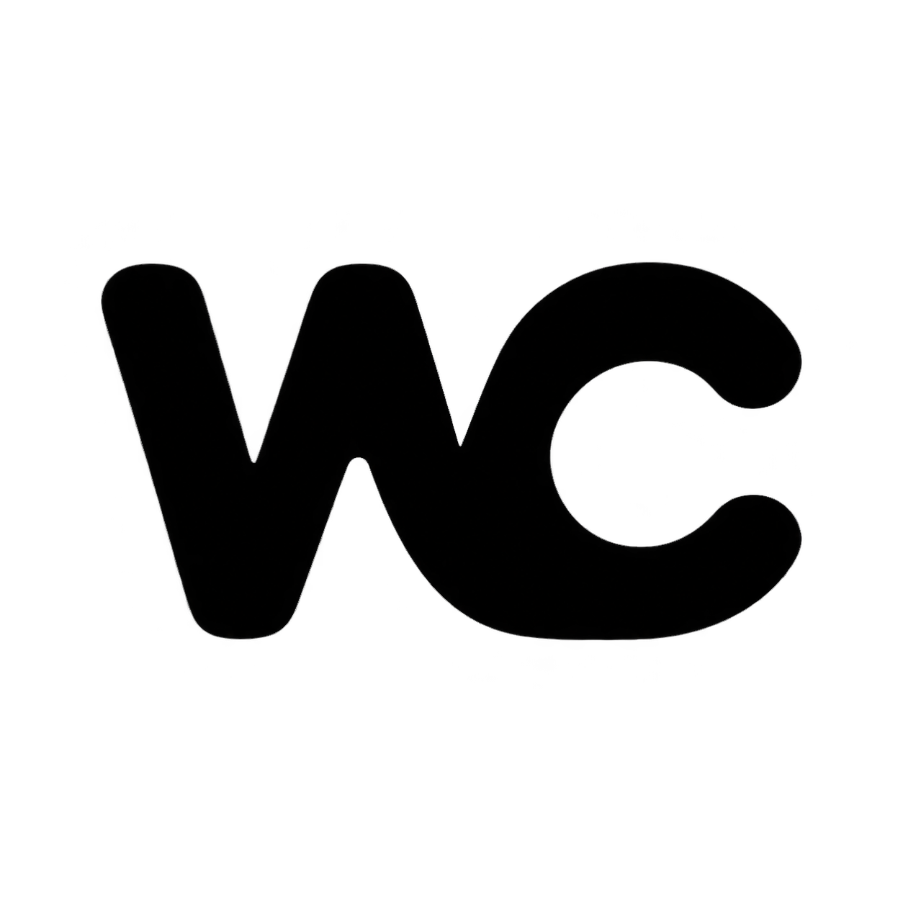

# Black and white app icon concepts

Five original concepts for RestRoom Finder, generated using the built-in image generation tool. Selection candidates only; not yet installed in the app asset catalog.

## 01-pin-restroom

Prompt:
A bold black map-pin silhouette centered on white. Inside the pin, one simple white toilet bowl silhouette in side profile is cut out as negative space. Fuse the two into one compact, immediately recognizable symbol. No tiny details.
Use case: logo-brand. Asset type: native iOS app icon concept for RestRoom Finder. Create ONE standalone square icon. User requires a concise memorable brand mark with the simplicity of major brands like Google, Xiaomi or McDonald's, but entirely original and not copying their logos. Strictly BLACK (#000000) and WHITE (#FFFFFF) only, apart from edge antialiasing. Flat, crisp vector-like raster rendering. Center the single mark within generous 20 percent safe margins, visually balanced. Full bleed solid background to all four edges, no pre-rounded outer icon corners. No gradients, shadows, texture, 3D, scenery, borders, mockups, labels, watermark, decorative elements or additional text. Professional logo exploration, optimize for recognition at 32 pixels.

## 02-r-monogram

Prompt:
A custom bold geometric uppercase R monogram in white centered on solid black. Its round upper counter is shaped subtly like the hole of a location pin and its diagonal leg ends in a precise directional point. One strong compact letterform, elegant and distinctive, extremely simple.
Use case: logo-brand. Asset type: native iOS app icon concept for RestRoom Finder. Create ONE standalone square icon. User requires a concise memorable brand mark with the simplicity of major brands like Google, Xiaomi or McDonald's, but entirely original and not copying their logos. Strictly BLACK (#000000) and WHITE (#FFFFFF) only, apart from edge antialiasing. Flat, crisp vector-like raster rendering. Center the single mark within generous 20 percent safe margins, visually balanced. Full bleed solid background to all four edges, no pre-rounded outer icon corners. No gradients, shadows, texture, 3D, scenery, borders, mockups, labels, watermark, decorative elements or additional text. Professional logo exploration, optimize for recognition at 32 pixels.

## 03-toilet-mark

Prompt:
A single bold black toilet silhouette in side profile centered on white. Reduce the tank, bowl and pedestal to three tightly integrated geometric forms, with a small negative-space separation. Confident modern pictogram with soft corners; instantly legible at tiny size.
Use case: logo-brand. Asset type: native iOS app icon concept for RestRoom Finder. Create ONE standalone square icon. User requires a concise memorable brand mark with the simplicity of major brands like Google, Xiaomi or McDonald's, but entirely original and not copying their logos. Strictly BLACK (#000000) and WHITE (#FFFFFF) only, apart from edge antialiasing. Flat, crisp vector-like raster rendering. Center the single mark within generous 20 percent safe margins, visually balanced. Full bleed solid background to all four edges, no pre-rounded outer icon corners. No gradients, shadows, texture, 3D, scenery, borders, mockups, labels, watermark, decorative elements or additional text. Professional logo exploration, optimize for recognition at 32 pixels.

## 04-doorway-pin

Prompt:
A single bold white symbol on solid black: a minimal open doorway whose interior negative space contains a simple location-pin silhouette. Use broad geometric strokes and very few shapes. Convey finding an entrance, clean and balanced. No perspective scene.
Use case: logo-brand. Asset type: native iOS app icon concept for RestRoom Finder. Create ONE standalone square icon. User requires a concise memorable brand mark with the simplicity of major brands like Google, Xiaomi or McDonald's, but entirely original and not copying their logos. Strictly BLACK (#000000) and WHITE (#FFFFFF) only, apart from edge antialiasing. Flat, crisp vector-like raster rendering. Center the single mark within generous 20 percent safe margins, visually balanced. Full bleed solid background to all four edges, no pre-rounded outer icon corners. No gradients, shadows, texture, 3D, scenery, borders, mockups, labels, watermark, decorative elements or additional text. Professional logo exploration, optimize for recognition at 32 pixels.

## 05-wc-ligature

Prompt:
A custom black WC typographic monogram on solid white. Bold rounded geometric W and C joined into a single compact logo with shared visual rhythm. Only the letters WC, very legible, distinctive silhouette, no other graphics.
Use case: logo-brand. Asset type: native iOS app icon concept for RestRoom Finder. Create ONE standalone square icon. User requires a concise memorable brand mark with the simplicity of major brands like Google, Xiaomi or McDonald's, but entirely original and not copying their logos. Strictly BLACK (#000000) and WHITE (#FFFFFF) only, apart from edge antialiasing. Flat, crisp vector-like raster rendering. Center the single mark within generous 20 percent safe margins, visually balanced. Full bleed solid background to all four edges, no pre-rounded outer icon corners. No gradients, shadows, texture, 3D, scenery, borders, mockups, labels, watermark, decorative elements or additional text. Professional logo exploration, optimize for recognition at 32 pixels.

